# 《아틀란의 크리스탈》 일반 서버 85레벨 장비 각인 · 주조 문양 코인

> 원문: [阿特兰情报站丨常规服拓印装备&铸纹币即将上线](https://www.taptap.cn/moment/857708547247440650)
>
> 정리일: 2026-10-10 / 비공식 한국어 현지화 / 대상: **일반 서버**
>
> **주의:** 원문 본문을 바탕으로 작성했다. 스크린샷 속 개별 수치와 UI는 원본 이미지 파일로 교차 검증하지 않았다. 이전에 생성된 판타지 포스터는 원본 스크린샷을 편집한 이미지가 아니므로 번역 자료로 사용하지 않는다.

## 용어 대조표

| 중국어 | 한국어 (임시) | 의미 |
|---|---|---|
| 拓印装备 | 각인 장비 | 신규 장비 시스템 |
| 稳固拓印 | 고정 각인 | 장비 고정, 추출 불가 |
| 活性拓印 | 활성 각인 | 추출 및 같은 부위 장착 가능 |
| 鉴定 / 批量鉴定 | 감정 / 일괄 감정 | 무작위 각인 획득 |
| 提取拓印 | 각인 추출 | 한 줄 추출, 원본 장비 파괴 |
| 嵌入拓印 | 각인 장착 | 교체 또는 빈 슬롯 확률 장착 |
| 拓孔 | 슬롯 확장 | 잠금 슬롯 개방 |
| 承转拓印 | 각인 계승 | 활성 각인 이전 |
| 拓印晶元 | 각인 결정 | 잠금 및 슬롯 확장 재료 |
| 拓印重构 / 词条洗炼 | 각인 재구성 / 옵션 재설정 | 옵션 수치 재추첨 |
| 铸纹币 | 주조 문양 코인 | 각인 관련 재화 |
| 铸纹币兑换券 | 주조 문양 코인 교환권 | 코인 교환 재료 |
| 封装器 | 봉인 도구 | 귀속된 장비 재거래용 |
| 塞诺丰 | 세노펀(가칭) | 85레벨 기간 한정 레이드 |

이 표의 한국어 명칭은 공식 현지화 확정값이 아니라 임시 번역이다.

## 1. 시스템 개요

- **85레벨 고급(精良) 등급 이상 장비**는 감정 시 무작위 각인 옵션·효과를 얻는다.
- 각인은 고정 각인과 활성 각인으로 나뉘며, 활성 각인만 추출해 같은 부위의 다른 장비에 장착할 수 있다.
- 레이드 에픽 장비에 티어가 추가된다. 상위 티어일수록 각인·효과가 많고 슬롯을 확장할 수 있다.
- 에픽 각인 장비는 감정 후에도 미귀속 상태로 거래 가능하다. 장착하면 귀속되므로 재거래 시 봉인 도구가 필요하다.

## 2. 감정과 추출

개별 감정 또는 일괄 감정으로 무작위 각인 효과를 획득한다. **고정 각인은 추출할 수 없다.** 활성 각인 중 원하는 **한 줄**을 추출할 수 있지만, **추출하면 원본 장비가 파괴된다.**

## 3. 장착과 잠금

- 각인 장착 시 현재 활성 각인 중 하나가 **무작위로 교체**된다.
- 빈 슬롯이 있다면 해당 슬롯에 장착될 확률이 있다. 교체 대상은 UI에서 강조 표시된다.
- 잠금으로 특정 활성 각인을 교체 대상에서 제외할 수 있다. 잠금 수는 개방 슬롯 수에 따라 달라진다.
- 잠금 재료인 **각인 결정(拓印晶元)**은 에픽 각인 장비 분해 시 확률적으로 획득하거나 거래소에서 구매한다.
- 일부 활성 각인은 동시에 존재할 수 없는 상호 배타 관계다. 특히 스킬 레벨 증가 각인을 주의해야 한다.

## 4. 슬롯 확장

에픽 각인 장비에 있는 잠긴 슬롯은 **각인 결정**을 소모해 개방한다. 개방 이후 각인을 장착할 때 새 슬롯에 들어갈 확률이 생기며, 슬롯 개방만으로 각인이 자동 추가되지는 않는다.

## 5. 각인 계승(承转)

새 장비의 **[장착] → [계승]** 화면에서 진행하며, 동일 부위·장비 티어·슬롯 상한·현재 슬롯 수 등 조건을 만족해야 한다.

| 항목 | 계승 결과 |
|---|---|
| 기존 장비의 활성 각인 | **100% 보존 및 이전** |
| 새 장비의 고정 각인 | **100% 보존** |
| 새 장비에 원래 있던 활성 각인 | 남은 슬롯에 따라 일부 보존될 수 있으나 전부 소실될 수도 있음 |

## 6. 각인 재구성 / 옵션 재설정

**주조 문양 코인(铸纹币)**을 사용해 고정·활성 각인의 옵션 수치를 재추첨한다.

1. 수치 범위는 장비 T등급에 따라 달라진다.
2. T등급별 재설정 횟수 상한은 같으며 각 옵션의 횟수는 독립적이다.
3. 활성 각인은 특정 아이템을 넣어 재추첨 범위를 높은 값으로 확장할 수 있다. 일정 수준 이상이면 ⭐ 표시가 붙는다.
4. 고정 각인은 특정 아이템으로 기존 수치 상한을 돌파할 수 없다.

## 7. 주조 문양 코인

85레벨 기간 한정 레이드 **「塞诺丰」**에서 **주조 문양 코인 교환권**을 얻고, 교환권과 골드를 사용해 코인으로 교환할 수 있다.

공지에서 명시한 사용처는 **장비 감정, 활성 각인 추출, 각인 계승, 거래소 각인 장비 구매** 및 앞 절의 **옵션 재설정**이다.

## 8. 10월 14일 버전 예고

85레벨 업데이트 「莱茵危局」, 메인 스토리 「浮城暗潮」, 라인성 상층 구역, 인벤터 3차 전직 **약제사** 등을 예고했다.

## 9. 공지 스크린샷 (14장)

> **원본 14장 모두 저장소에 보관**했다. 오른쪽 열은 이미지 생성 도구로 번역을 시도한 **한국어 편집 시안(검수 전)**이다. 원본 이미지의 아이콘·세부 UI·아이템 이름·옵션 수치가 변형되었을 수 있으므로 **정확한 원문 자료로 인용하거나 공식 번역 이미지로 배포하면 안 된다.** 특히 고유 명칭과 수치는 왼쪽 원본을 우선 확인한다.

> 출처: [TapTap 공식 공지](https://www.taptap.cn/moment/857708547247440650). 원문 공지에 표시된 장비 수치는 시연용 예시다.

| 번호 · 장면 | 원본 스크린샷 | 한국어 편집 시안 (검수 전) |
|:--|:--:|:--:|
| 01 · 장비 감정 진입 | 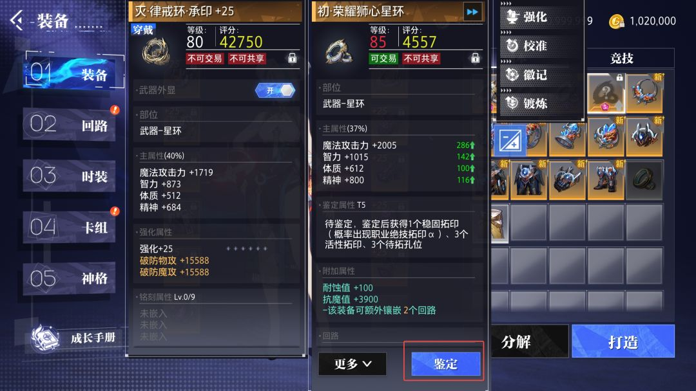 |  |
| 02 · 일괄 감정 메뉴 | 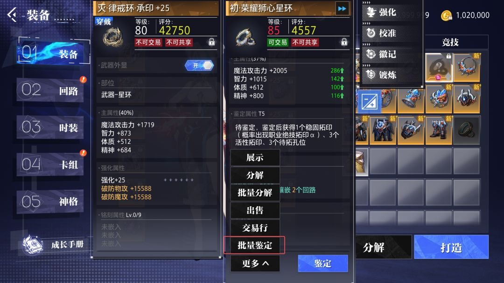 |  |
| 03 · 감정 결과 | 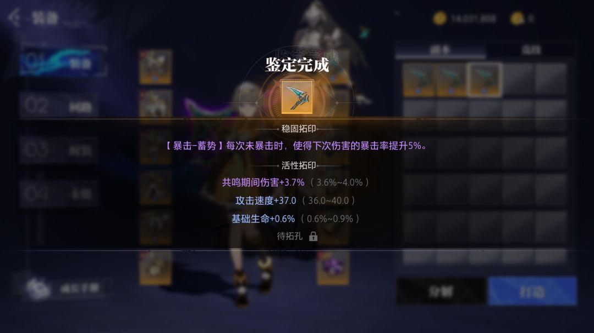 |  |
| 04 · 장비 각인 진입 | 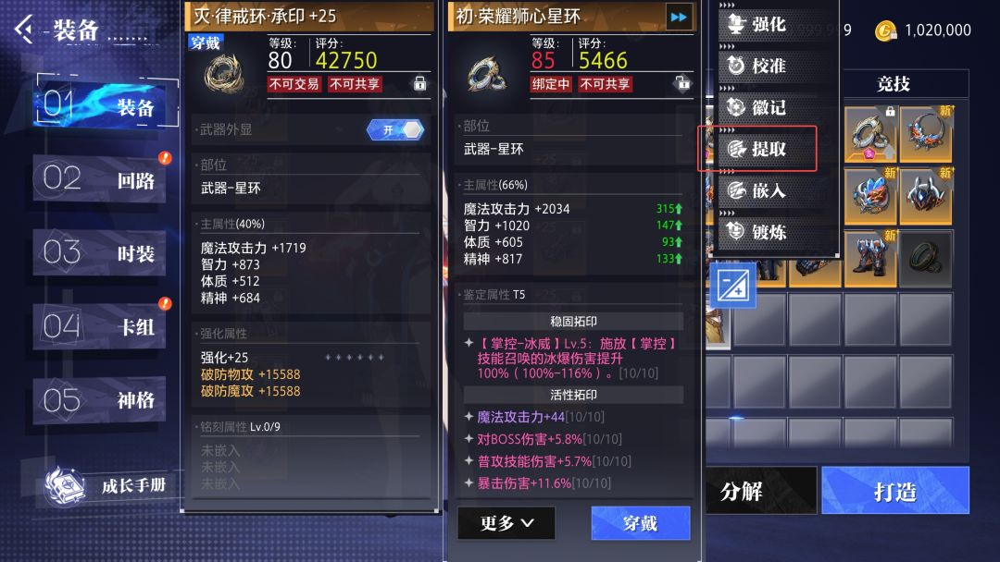 |  |
| 05 · 각인 추출 옵션 선택 | 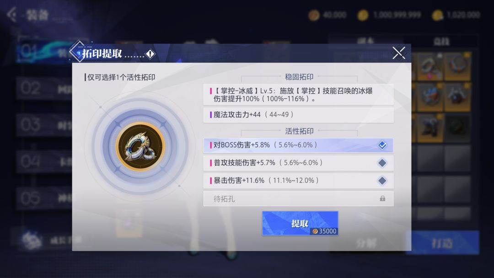 |  |
| 06 · 활성 각인 추출 결과 | 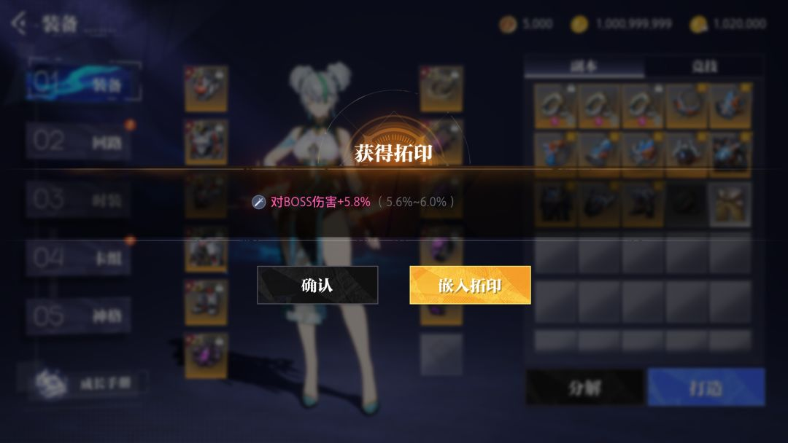 |  |
| 07 · 각인 장착 진입 | 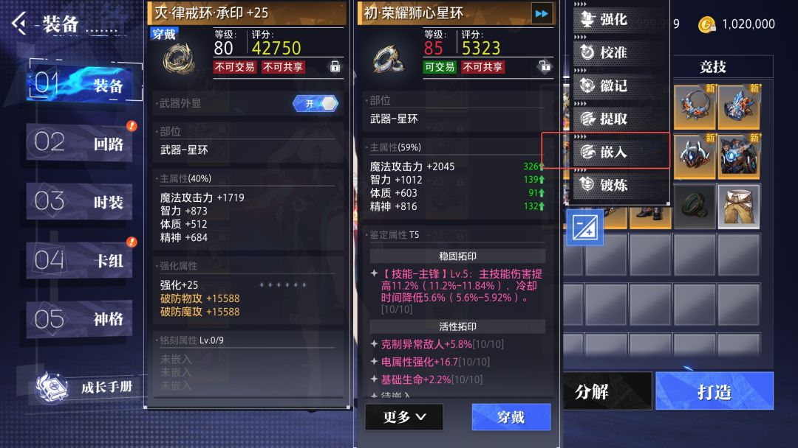 |  |
| 08 · 각인 잠금 예시 | 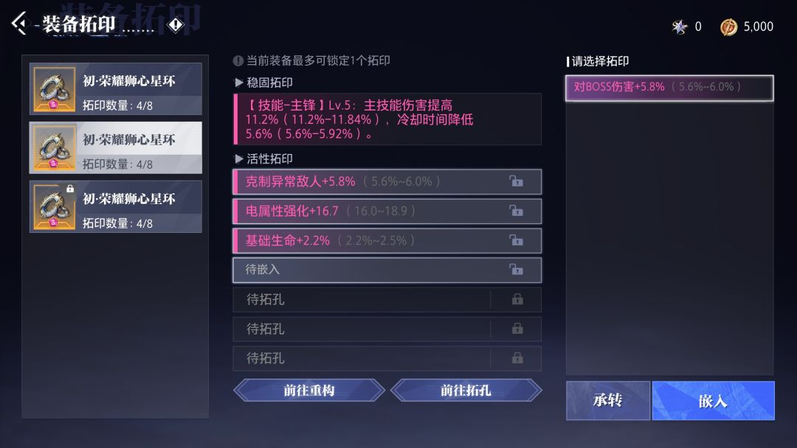 | 아직 편집본 없음 |
| 09 · 각인 잠금 적용 |  | 아직 편집본 없음 |
| 10 · 상위 티어 장비 각인 예시 | 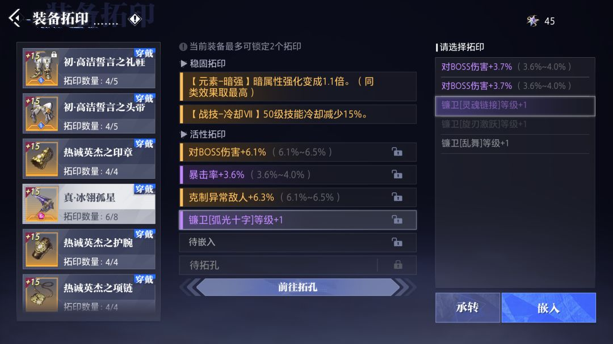 |  |
| 11 · 슬롯 확장 이동 |  | 아직 편집본 없음 |
| 12 · 슬롯 확장 화면 | 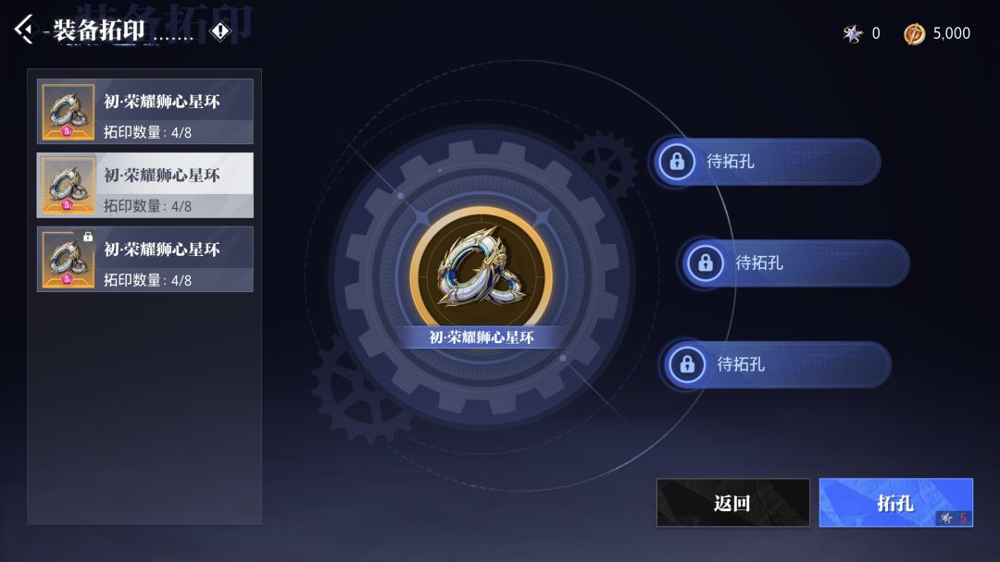 |  |
| 13 · 각인 계승 진입 | 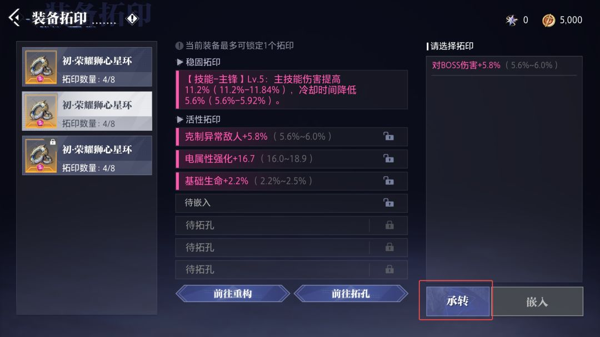 | 아직 편집본 없음 |
| 14 · 각인 계승 결과 비교 | 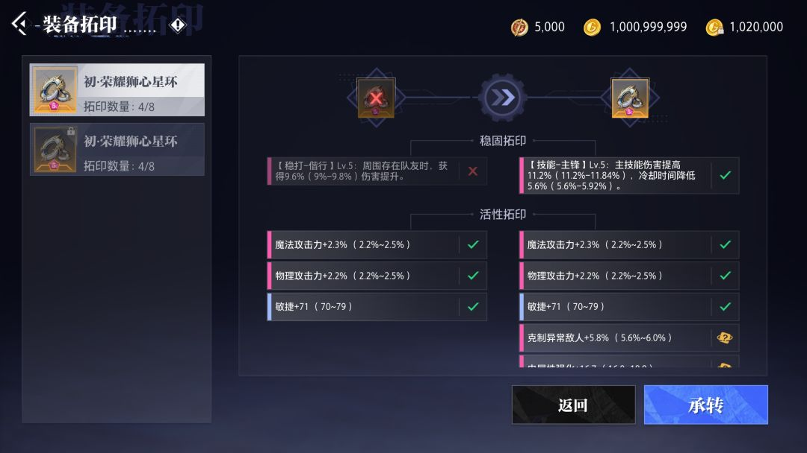 |  |

### 이미지 사용 및 검수 현황

- ✅ 중국어 원본: **14/14장**, ZIP에서 누락 없이 수록
- 🟡 한국어 편집 시안: **10/14장**, 자동 생성 이미지로 **텍스트·원본 보존 검수 미완료**
- ⏳ 시안 미제작: **08, 09, 11, 13번**
- 수치·품목명·아이콘에 차이가 있으면 **원본(왼쪽)을 정본으로 취급**한다.
- 향후 검증된 번역본으로 교체할 때도 원본을 삭제하지 않는다.

