# 《아틀란의 크리스탈》 일반 서버 85레벨 장비 각인 · 주조 문양 코인

> **TapTap 공식 공지:** [阿特兰情报站丨常规服拓印装备&铸纹币即将上线](https://www.taptap.cn/moment/857708547247440650)  
> **한국어 비공식 현지화:** 2026-10-10 · **대상: 일반 서버**  
> **읽는 순서:** 아래 그림은 공지의 진행 순서에 따라 **01~14번을 각각 한 장씩** 배치했다. 그림 속 용어 및 장비 능력치는 검수가 끝난 공식 한국어 UI가 아닌 *자동 편집 시안*이므로 수치·아이템명·그림이 원문과 다를 수 있다. 정확한 판정에는 링크된 공식 공지를 확인한다.

## 시스템 개요

- **85레벨 고급(精良) 등급 이상 장비**를 감정하면 무작위 각인 옵션이 부여된다.
- 각인은 **고정 각인(稳固拓印)**과 **활성 각인(活性拓印)**으로 나뉜다. 활성 각인은 추출해서 동일 부위의 다른 장비에 장착할 수 있다.
- 레이드 에픽 장비에는 티어가 도입된다. 상위 티어 장비는 더 많은 각인 효과와 슬롯 확장 기회를 갖는다.
- 에픽 각인 장비는 감정 후 거래 가능하지만 **장착하면 귀속**된다. 재거래할 때는 봉인 도구가 필요하다.

## 1. 감정으로 각인 부여하기

### 01 · 장비 감정 메뉴

85레벨 장비에서 **감정** 기능을 선택하면 감정 가능한 장비에 무작위 각인이 부여된다. 아직 감정하지 않은 장비의 옵션 영역을 살펴보자.

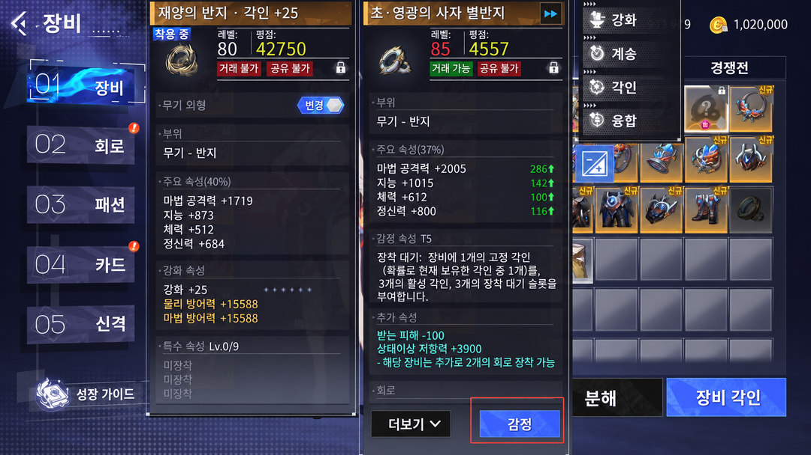

### 02 · 일괄 감정

장비 메뉴의 **더보기 → 일괄 감정** 경로를 사용하면 여러 장비를 한 번에 감정할 수 있다. 아래 화면은 일괄 감정 선택 위치를 보여준다.

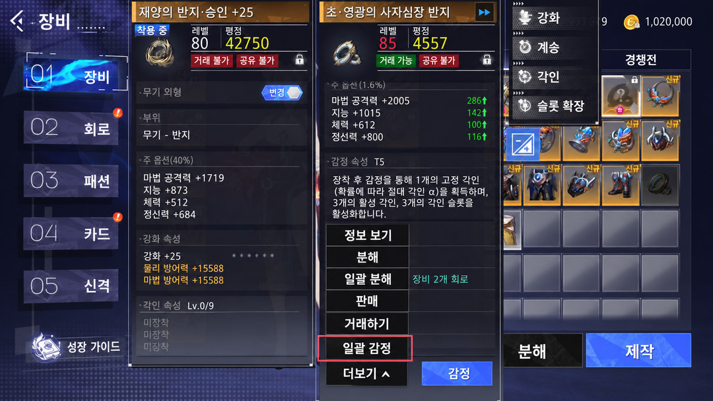

### 03 · 감정 완료와 각인 구성

감정 결과에는 장비에 고정되는 **고정 각인**, 이동 가능한 **활성 각인**, 그리고 아직 열리지 않은 **추가 슬롯**이 구분돼 나타난다. 예시 옵션 수치는 시연용이다.

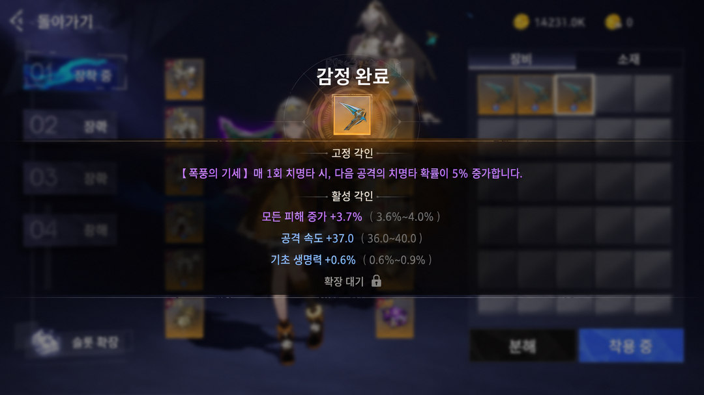

## 2. 활성 각인 추출하기

### 04 · 장비 각인 메뉴 진입

장비 상세 화면에서 **장비 각인** 메뉴를 열면 해당 장비의 고정·활성 각인을 확인할 수 있다.

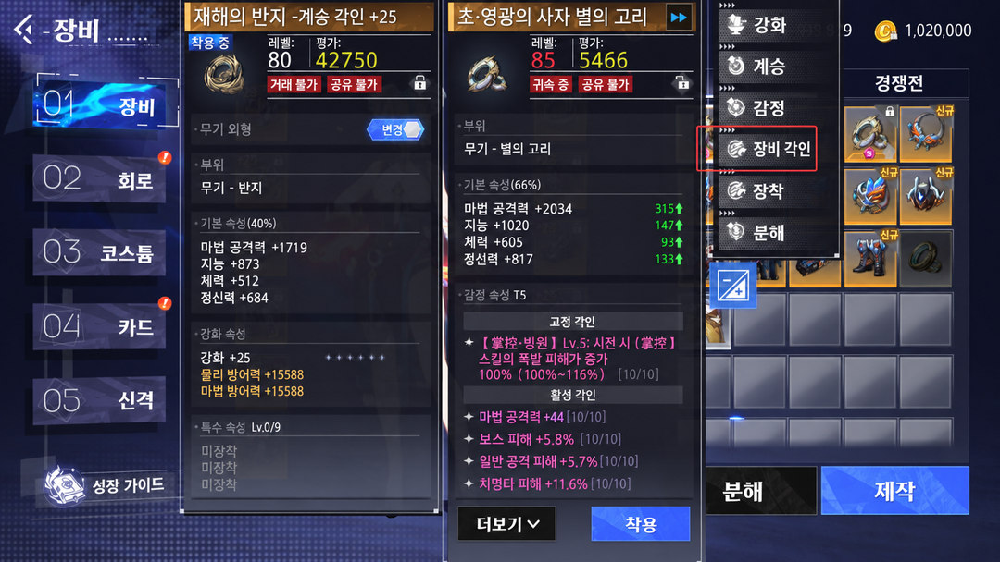

### 05 · 추출할 활성 각인 선택

추출하려는 **활성 각인 하나**를 선택한다. **고정 각인은 추출할 수 없다.** 아래 화면은 추출 확인 창과 재료·비용 표시의 위치를 보여준다.

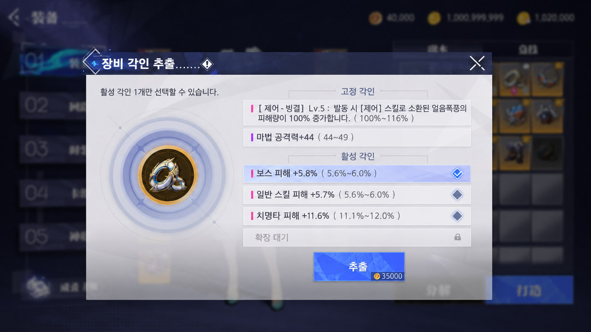

### 06 · 각인 추출 결과

선택한 활성 각인을 추출하면 다른 동일 부위의 장비에 활용할 수 있다. **주의: 추출 완료 시 원본 장비는 파괴된다.**

## 3. 각인 장착과 잠금

### 07 · 장착할 각인 고르기

추출한 활성 각인을 선택해 동일 부위 장비에 **장착**한다. 기존 활성 각인 중 한 개가 무작위로 교체되며, 비어 있는 슬롯이 있다면 그 슬롯에 들어갈 확률도 있다.

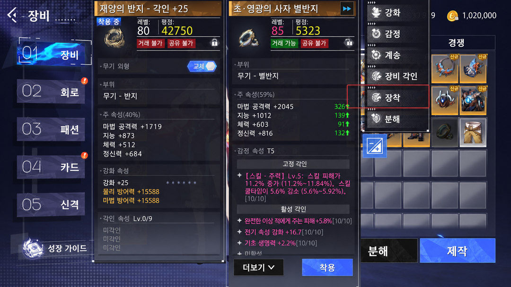

### 08 · 잠금 전: 교체 가능 상태 확인

기존 옵션을 보호하려면 **잠금** 기능을 사용한다. 잠기지 않은 활성 각인은 교체 대상으로 표시될 수 있다. 화면 오른쪽에는 새로 장착할 각인이 표시된다.

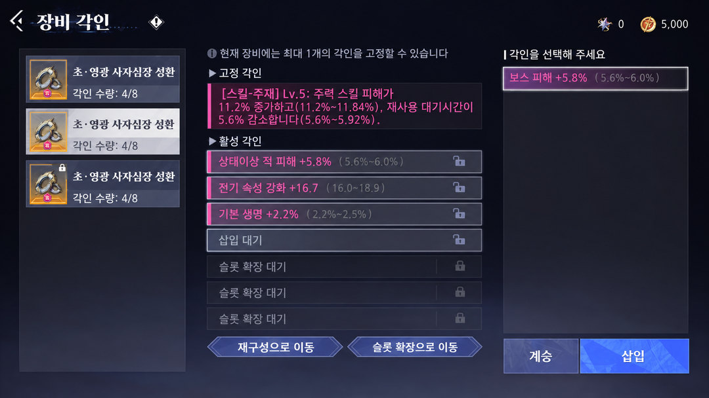

### 09 · 잠금 후: 보호할 옵션 고정

잠금 표시를 적용하면 해당 활성 각인은 무작위 교체 대상에서 제외된다. **잠금 개수는 장비의 열린 슬롯 수에 따라 달라지며**, **각인 결정(拓印晶元)**을 소모한다. 일부 상호 배타적인 스킬 레벨 각인은 별도 제한이 적용될 수 있다.

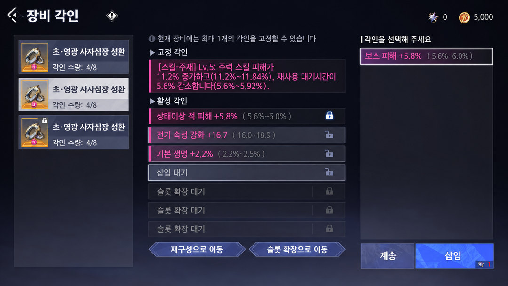

## 4. 상위 티어 장비와 슬롯 확장

### 10 · 상위 티어 각인 예시

상위 티어 에픽 장비는 고정·활성 각인과 교체 후보가 더 많이 표시될 수 있다. 아래 그림은 장비별 잠금 가능한 옵션 수와 선택 후보를 이해하기 위한 예시다.

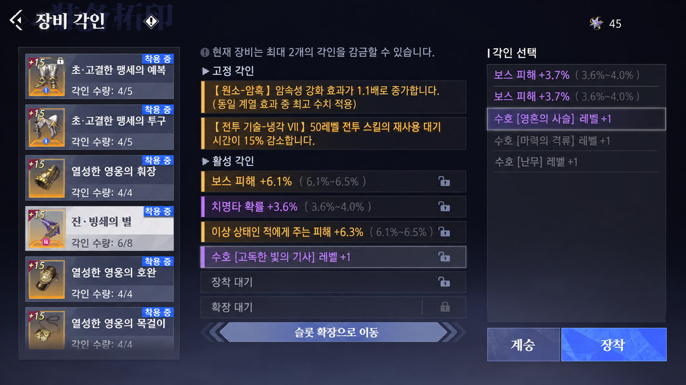

### 11 · 슬롯 확장으로 이동

장비의 아직 열리지 않은 슬롯을 사용하려면 **슬롯 확장으로 이동**을 선택한다. 공지의 11번 장면은 해당 버튼 위치를 강조한다.

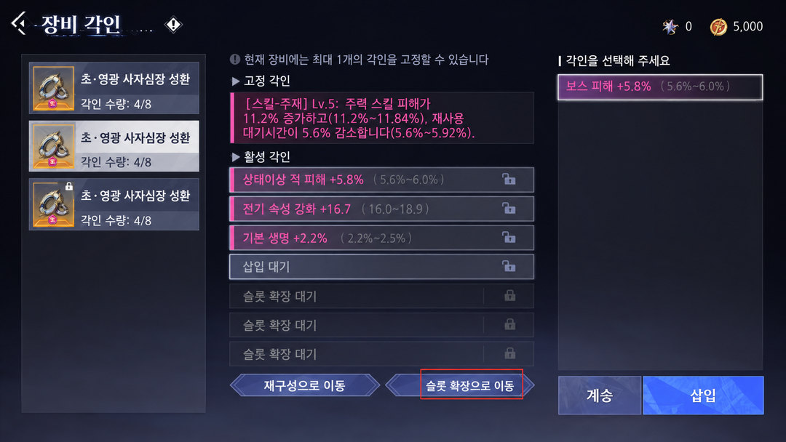

### 12 · 슬롯 확장

에픽 장비의 잠긴 슬롯은 **각인 결정**을 소모해 열 수 있다. 슬롯을 개방해도 곧바로 각인이 들어오는 것은 아니며, 이후 각인 장착 과정에서 빈 슬롯으로 들어갈 확률이 생긴다.

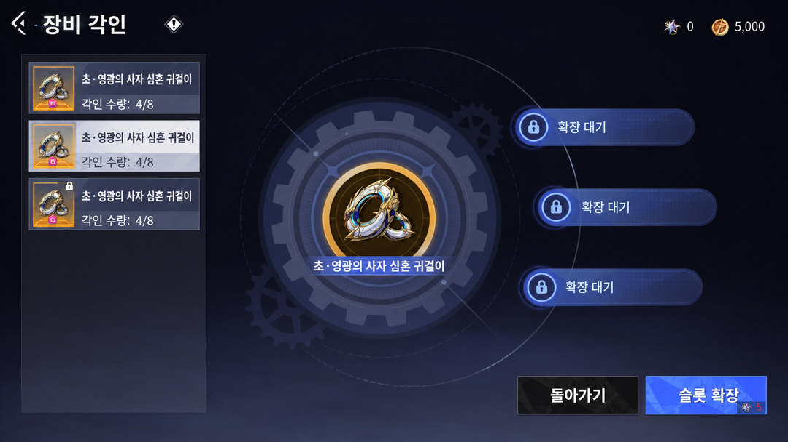

## 5. 기존 옵션을 새 장비로 계승하기

### 13 · 각인 계승 진입

기존 장비에서 새로운 장비로 바꿀 때는 **계승(承转)**을 사용한다. 원문의 13번 화면은 장착 화면에서 계승 버튼으로 이동하는 단계다.

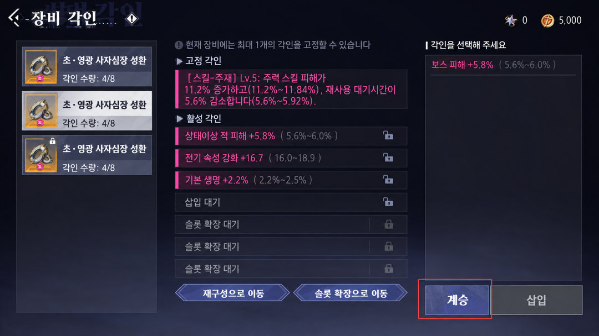

### 14 · 계승 전후 옵션 비교

계승 시 적용 원칙을 비교하면 다음과 같다.

| 구성 | 계승 후 처리 |
|---|---|
| 기존 장비의 **활성 각인** | **100% 보존 및 이전** |
| 새 장비의 **고정 각인** | **100% 보존** |
| 새 장비에 원래 있던 **활성 각인** | 남는 슬롯에 따라 일부 보존될 수 있으나, 모두 사라질 수도 있음 |

동일 장비 부위 여부, 티어·슬롯 상한 및 현재 슬롯 수 등의 조건을 만족해야 한다. 그림의 체크·삭제 표시는 어떤 각인이 유지되거나 사라지는지 구별하는 데 사용된다.

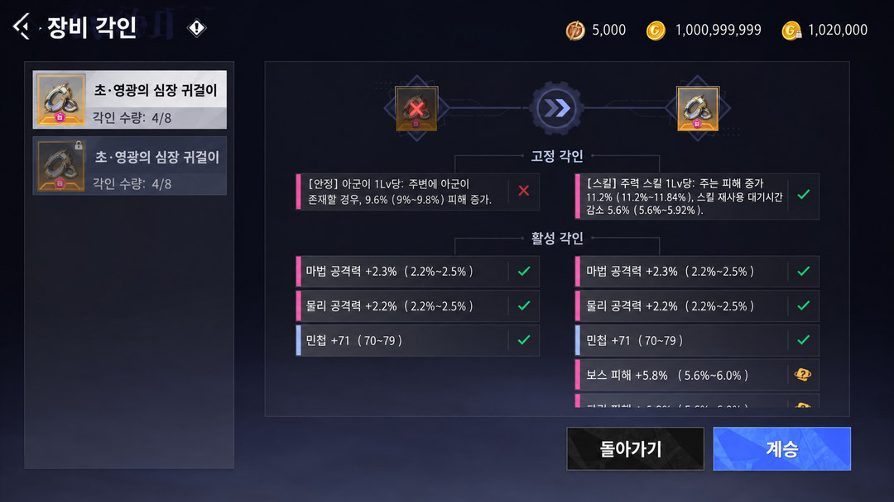

## 6. 옵션 재설정: 각인 재구성

**주조 문양 코인(铸纹币)**을 사용해 고정·활성 각인 옵션 수치를 재설정할 수 있다.

1. 수치 범위는 장비 **T등급**에 따라 달라진다.
2. T등급별 재설정 횟수 상한은 같으며, 옵션별 횟수는 독립적으로 계산된다.
3. 활성 각인은 특정 아이템을 사용해 재설정 상한을 확장할 수 있다. 일정 수준 이상은 ⭐ 표시로 구분된다.
4. 고정 각인은 전용 아이템으로 수치 상한을 돌파할 수 없다.

## 7. 재료 획득과 사용처

- **각인 결정(拓印晶元):** 에픽 각인 장비 분해 시 확률적으로 얻거나 거래소에서 구매한다. 각인 잠금과 슬롯 확장에 사용된다.
- **주조 문양 코인(铸纹币):** 85레벨 기간 한정 레이드 **「塞诺丰」(임시 표기)**의 교환권과 골드를 사용해 교환한다. 감정, 추출, 계승, 거래소 각인 장비 구매 및 재구성 등에 사용된다.

## 8. 함께 예고된 85레벨 업데이트

10월 14일 85레벨 버전 **「莱茵危局」**, 신규 메인 스토리 **「浮城暗潮」**, 라인성 상층 구역, 인벤터 3차 전직 **약제사** 등을 함께 예고했다.

## 용어 대조표 (공식 한국어 명칭 미확인 항목은 임시 표기)

| 중국어 | 한국어 임시 표기 | 비고 |
|---|---|---|
| 拓印装备 | 각인 장비 | 신규 장비 육성 |
| 稳固拓印 | 고정 각인 | 추출 불가 |
| 活性拓印 | 활성 각인 | 추출·장착 가능 |
| 鉴定 / 批量鉴定 | 감정 / 일괄 감정 | 여러 장비 감정 지원 |
| 提取拓印 | 각인 추출 | 원본 장비 파괴 |
| 嵌入拓印 | 각인 장착 | 무작위 교체·빈 슬롯 확률 장착 |
| 拓孔 | 슬롯 확장 | 잠긴 슬롯 개방 |
| 承转拓印 | 각인 계승 | 활성 각인 이전 |
| 拓印晶元 | 각인 결정 | 잠금·슬롯 확장 |
| 拓印重构 / 词条洗炼 | 각인 재구성 / 옵션 재설정 | 옵션 수치 조정 |
| 铸纹币 | 주조 문양 코인 | 시스템 재화 |
| 铸纹币兑换券 | 주조 문양 코인 교환권 | 레이드 보상 교환 재료 |
| 封装器 | 봉인 도구 | 장비 거래 |
| 塞诺丰 | 세노펀(임시) | 레이드 |

---

**편집 이력:** ZIP 제공 스크린샷 14개의 번호와 원문 설명 순서를 기준으로 배치했다. 이 문서는 **한국어 편집 시안 14장만 표시**하며, 원본 이미지는 현재 문서 및 저장소의 해당 에셋 폴더에서 제외했다. 이전 Git 커밋의 파일 이력은 Git 특성상 별도로 남을 수 있다.